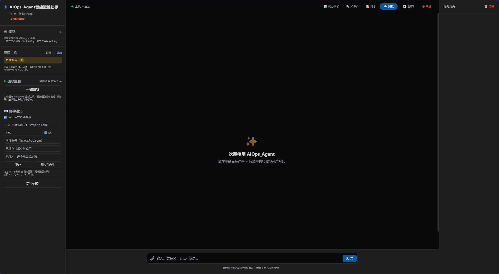
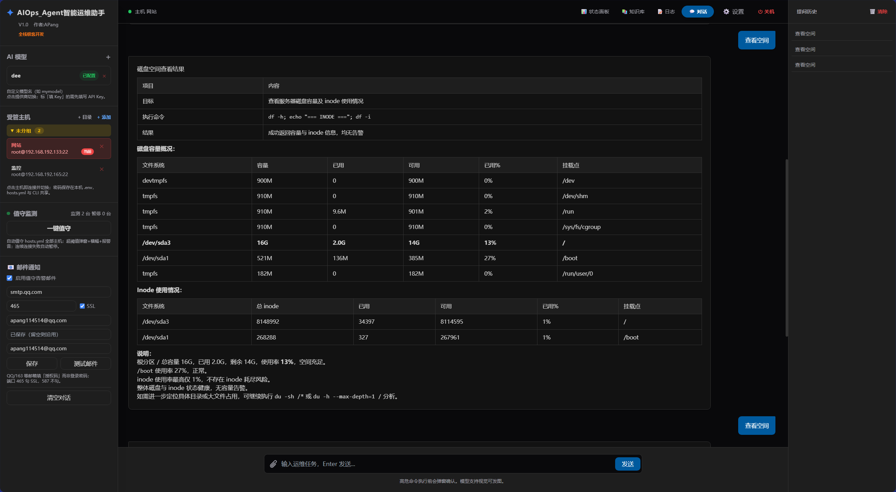
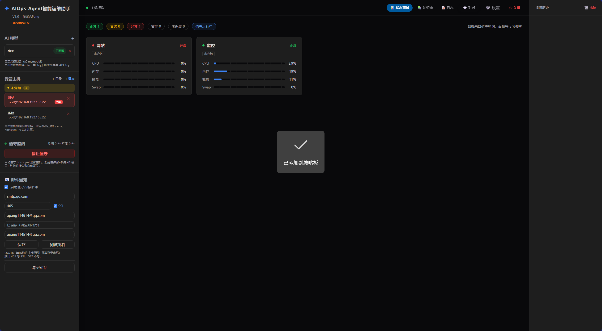
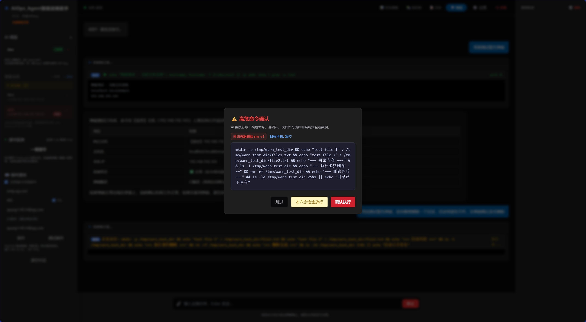
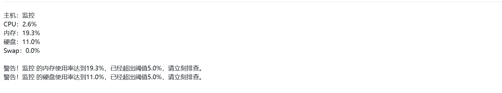

<div align="center">

# AIOps_Agent · 智能运维助手

**用中文说句话，让 AI 自己 SSH 上去把活干完。**

把「连服务器、看负载、查日志、排故障、批量改配置」这些重复劳动，交给一个会自己动手、还能被你随时喊停的 AI 助手。

[](https://www.python.org/)
[](https://fastapi.tiangolo.com/)
[](LICENSE)
[](https://github.com/AAAAAPang/AIOps_Agent/releases)
[](https://github.com/AAAAAPang/AIOps_Agent/issues)

</div>

---

## 📖 这是什么

AIOps_Agent 是一个**跑在自己电脑上的 AI 运维工作台**。

你在网页对话框里用自然语言描述需求 —— *“看看 web-01 的磁盘怎么满了，把大文件清一下”*、*“查一下这三台机器上 nginx 的版本是不是一致”* —— AI 会自己规划步骤、调用 SSH 在目标主机上执行命令、读取真实输出、判断结果、继续下一步，最后给你一份 Markdown 总结。

它不是「帮你生成命令让你自己粘贴」，而是**真的连上去执行**；同时它也不是「把所有命令一把梭」——高危操作会弹窗让你确认，任何时候都能一键叫停。

整套东西是**单机本地部署**：服务只监听 `127.0.0.1`，主机密码加密后存在本地 SQLite，AI 只通过你自己填的 API Key 对外请求，不经过任何第三方中转服务器。

> 适合谁：需要同时管几台到几十台 Linux 主机、又不想每次都手敲命令的开发者 / 运维 / 小团队。
> 不适合谁：需要多租户、RBAC、审计合规的企业级堡垒机场景（本项目不是堡垒机，也不打算做成堡垒机）。

---

## 📸 界面预览

**主界面** —— 左侧 AI 模型与受管主机，中间对话区，右侧提问历史；三套主题可切换。



**一句话完成巡检** —— “查看磁盘空间”，AI 自动执行 `df -h` 与 `df -i`，把容量与 inode 用量整理成表格并给出结论。



**值守监控大盘** —— 定时采集 CPU / 内存 / 磁盘 / Swap，卡片式展示，异常主机置顶标红。



**高危命令二次确认** —— 命中 `rm -rf`、`reboot`、`shutdown` 等规则时，执行前必须人工放行。



**超阈值邮件告警** —— 值守阶段触发阈值时，自动把当前指标与告警项发到你的邮箱。



---

## ✨ 核心功能

| 能力 | 说明 |
| --- | --- |
| 🤖 **自然语言运维** | 一句话下发任务，AI 自主多轮调用工具直到完成，不用你一条条写命令 |
| 🖥️ **多主机统一管理** | 主机按目录分组，AI 可根据任务自动切换目标主机（“去监控机上看看”） |
| 🔁 **连续执行机制** | 拿到上一步真实输出后自动继续下一步，而不是聊两句就断片 |
| 🛡️ **三层安全护栏** | 危险命令正则拦截 → 高危命令弹窗确认 → 一键停止 / 任务中断后“继续” |
| 📊 **值守监控大盘** | 定时轮询 CPU / 内存 / 磁盘 / Swap，卡片式看板，超阈值红色告警 + 提示音 |
| 📧 **邮件告警** | 阈值触发自动发邮件（支持 QQ / 163 授权码，30 分钟内同主机去重） |
| 📚 **本地知识库** | 挂载本地目录，AI 回答时自动读取其中的文档、脚本、配置作为上下文 |
| 🧠 **任意 OpenAI 兼容模型** | DeepSeek / Qwen / Moonshot / GPT / 本地 Ollama、vLLM 都能接，支持视觉模型发图 |
| 📝 **执行审计** | 每条命令写进 SQLite 与按天滚动的文本日志，事后可查 |
| 🎨 **三套主题** | 极客黑 / 樱花粉 / 赛博蓝，设置里一键切换 |

---

## 🚀 快速开始（源码运行）

### 环境要求

- Python **3.10+**（3.12 已验证）
- Windows 10/11（核心逻辑跨平台，Tkinter 选目录弹窗在 Linux/macOS 上需自行适配）
- 被管理主机开启 SSH，并有一个可用的账号

### 三步启动

```bash
git clone https://github.com/AAAAAPang/AIOps_Agent.git
cd AIOps_Agent

python -m venv .venv
# Windows
.venv\Scripts\activate
# macOS / Linux
# source .venv/bin/activate

pip install -r requirements.txt
python src/main.py
```

启动后浏览器会自动打开 **<http://127.0.0.1:8010>**（没弹出就手动访问）。

> 想换端口：`set AIOPS_PORT=9000`（PowerShell 用 `$env:AIOPS_PORT=9000`）后再启动。

### 首次使用的三件事

1. **加模型** —— 左下「AI 模型 → +」，填名称、Base URL、模型名、API Key。
   例：`https://api.deepseek.com` + `deepseek-chat`；或 Ollama：`http://127.0.0.1:11434/v1` + `qwen2.5:7b`。
2. **加主机** —— 「受管主机 → + 添加」，填名称、IP、端口、用户名、密码（可分组）。
3. **开聊** —— 左侧点主机、点模型，输入任务，回车。

试试这些指令：

```
看一下这台机器的 CPU 和内存占用
检查磁盘空间，找出 /var/log 下最大的 5 个文件
确认 nginx 是否在运行，没运行就拉起来并告诉我原因
把 web-01、web-02 的时区都改成 Asia/Shanghai
```

---

## 📦 开箱即用（打包版）

不想装 Python？直接下成品：

1. 打开 [**Releases**](https://github.com/AAAAAPang/AIOps_Agent/releases) 页面，下载最新版的 `AIOps_Agent.zip`
2. 解压到任意目录（**路径别带中文和空格**更稳）
3. 双击 `AIOps_Agent.exe`，浏览器自动打开界面
4. 关闭黑色命令行窗口 = 退出程序

打包版为 Windows x64 单目录（onedir）形式，无需安装、无需 Python 环境。首次运行会在同目录生成 `system.db`、`logs/`、`secret.key` 等运行时文件，**升级时不要删除它们**。

---

## ⚙️ 配置说明

大部分配置在界面「⚙️ 设置」里改，即时生效并落库到 `settings` 表。

| 配置项 | 默认 | 说明 |
| --- | --- | --- |
| `interval` | 30 | 监控采集间隔（秒），最小按 5 秒执行 |
| `th_cpu` / `th_mem` | 90 / 90 | CPU / 内存告警阈值（%） |
| `th_disk` / `th_swap` | 85 / 70 | 磁盘 / Swap 告警阈值（%） |
| `max_rounds` | 10000 | 单次任务内 AI 最多连续调用工具轮数 |
| `max_context` / `keep_context` | 100 / 45 | 送模型的上下文条数 / 裁剪后保留条数 |
| `smtp_*`、`to_email` | 空 | 邮件告警的 SMTP 配置，多个收件人用逗号分隔 |

### 环境变量

| 变量 | 作用 |
| --- | --- |
| `AIOPS_SECRET_KEY` | 覆盖主机密码加密所用的 Fernet 密钥（不设则自动生成 `secret.key`） |
| `AIOPS_PORT` | 覆盖监听端口，默认 `8010` |
| `AIOPS_SMTP_INSECURE` | 设为 `1` 时跳过 SMTP 证书校验（仅用于证书链异常的临时排查） |

---

## 🗂 项目结构

```
AIOps_Agent/
├── src/
│   ├── main.py          # 后端：FastAPI + SSH 执行引擎 + 监控调度 + AI Agent 循环
│   └── index.html       # 前端：单文件页面（Tailwind CDN + Markdown 渲染）
├── build/
│   └── build.ps1        # 一键 PyInstaller 打包脚本
├── docs/
│   ├── BUILD.md         # 打包与发版说明
│   └── screenshots/     # 界面截图
├── requirements.txt
├── .gitignore
├── LICENSE
└── README.md
```

运行时生成（已被 `.gitignore` 忽略）：`system.db`（主机/模型/设置/日志）、`secret.key`（加密密钥）、`logs/`、`uploads_images/`。

---

## 🔍 工作原理

```
浏览器 (index.html)
   │  WebSocket /ws        HTTP /api/*
   ▼
FastAPI (main.py)
   ├── Agent 循环：OpenAI 兼容 Chat Completions + function calling
   │        └─ 工具 execute_ssh_command(command, target_host?)
   ├── SSH 执行引擎：paramiko，实时回传 stdout/stderr，支持中断
   ├── 安全层：DANGEROUS_PATTERNS 正则拦截 + 前端高危弹窗确认
   ├── 监控调度：asyncio 定时任务并发采集，超阈值发邮件
   └── SQLite：servers / ai_configs / settings / logs / chat_history / kb_dirs
```

AI 的一次任务大致是这样的闭环：

```
用户指令 → 模型决定调用工具 → 沙箱正则校验 → SSH 执行
        → 真实输出回填 messages → 模型继续决策 → … → 输出总结
```

关键点在于**工具结果必须来自真实执行**，模型不允许编造输出；命令失败时退出码会一并回填，让模型自己纠错重试。

---

## 🔐 安全设计（务必读完）

这个工具会把你的 SSH 凭据和命令执行能力交给一个模型，所以请认真对待下面几条：

1. **只监听本机。** 服务绑定 `127.0.0.1`，默认不对外网开放。要远程访问请用 SSH 隧道，不要改成 `0.0.0.0`。
2. **密码加密存储。** 主机密码用 Fernet 加密后写入 SQLite；密钥优先取 `AIOPS_SECRET_KEY`，否则在本机生成 `secret.key`。**`secret.key` 和 `system.db` 绝不能进版本库**，仓库已通过 `.gitignore` 排除。
3. **模型 API Key 目前明文存库。** 这是已知限制（见 Roadmap），请确保本机与数据库文件的安全。
4. **高危命令拦截是最后一道防线，不是沙箱。** 正则黑名单只能挡住明显的 `rm -rf /`、`mkfs`、`dd`、`reboot` 之类；真正危险的命令千变万化，**不要指望它 100% 拦得住**。
5. **强烈建议给 AI 使用最小权限账号**（非 root，或只给需要的 sudo 白名单），而不是直接上 root。
6. **确认弹窗请认真看。** “本次会话全放行”会静默执行后续所有高危命令，用完记得立刻关掉（界面顶部有红色横幅提醒）。
7. **每台机器一把钥匙。** 加密密钥在首次运行时随机生成，仅存在于本机程序目录；换机器 / 重装时请连同 `secret.key` 一起迁移，否则已保存的主机密码需要重新录入。

---

## ❓ FAQ

**Q：会不会把我的命令发到别人服务器？**
A：不会。命令只通过 SSH 发给你配置的主机；对话内容只发给你自己填的模型 API（OpenAI 兼容接口）。项目没有任何遥测或中转服务。

**Q：支持 Windows 主机吗？**
A：执行层是标准 SSH，目标机装好 OpenSSH Server 就能连；监控采集脚本用的是 Linux 的 `free`/`df`/`/proc/stat`，Windows 主机目前只能执行命令，采集不到指标。

**Q：华为交换机之类的网络设备行不行？**
A：理论上 SSH 可达即可，但监控采集脚本不适配 VRP，界面里的相关提示是早期版本遗留文案，以实际行为为准。

**Q：邮件发不出去 / 报 SSL 错误？**
A：先确认用的是**邮箱授权码**而不是登录密码，端口 465 勾 SSL、587 不勾；程序已强制使用 IPv4 解析并使用系统证书校验。若你的网络确实存在证书拦截，可临时设置 `AIOPS_SMTP_INSECURE=1` 跳过校验（不建议长期使用）。

**Q：为什么 AI 一直说“命令执行成功”但没输出？**
A：去看对话里展开的命令块，那里是真实 stdout/stderr。模型总结可能与实际有偏差，**以命令块为准**。

**Q：数据存在哪？能备份吗？**
A：全部在程序目录：`system.db`（核心数据）+ `secret.key`（解密密钥）。迁机器时两个一起拷走即可。

---

## 🗺 Roadmap

- [ ] AI 配置项（API Key）加密存储
- [ ] 主机凭据支持密钥登录 / SSH Agent
- [ ] 命令白名单模式（只允许只读巡检类命令）
- [ ] 监控历史曲线（当前只存最新一次快照）
- [ ] 跨平台打包（macOS / Linux 产物）
- [ ] 单元测试与 CI

有想法欢迎开 Issue 讨论，别客气。

---

## 🤝 参与贡献

1. Fork 本仓库并新建分支：`git checkout -b feat/your-feature`
2. 提交改动：`git commit -m "feat: 你的改动"`
3. 推送并发起 Pull Request

提交前请确认：没有把 `system.db`、`secret.key`、`logs/`、真实主机 IP / 密码 / API Key 带进 diff。

如果这个项目帮到了你，点个 ⭐ Star 就是最大的支持。

---

## 📄 License

[MIT](LICENSE) © 2026 APang

## ⚠️ 免责声明

本项目按“现状”提供，不附带任何担保。它拥有在你服务器上执行命令的能力，**请自行评估风险并在测试环境先行验证**。因使用本工具造成的任何数据丢失、服务中断或其他损失，作者不承担责任。
